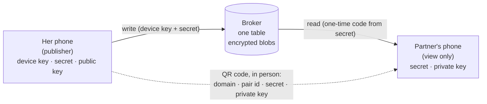
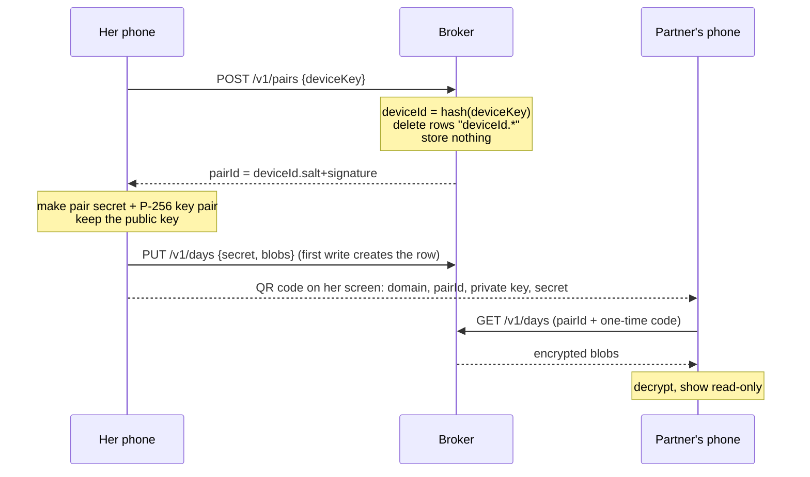
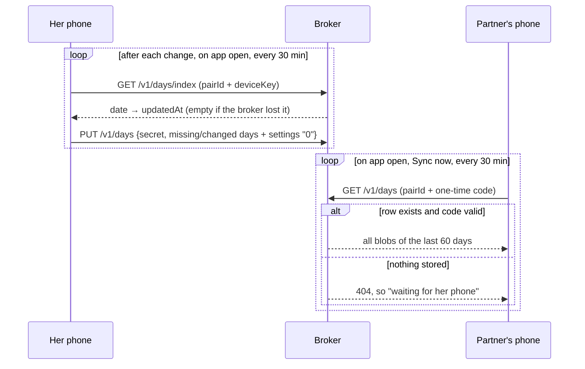
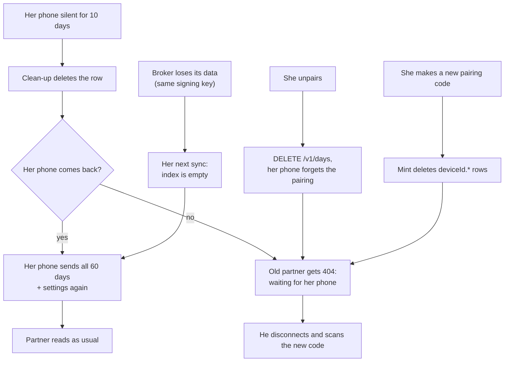

# Design

## In one sentence

The broker is a **dumb, disposable cache**: it signs pair ids without remembering them, keeps the
encrypted blobs her phone writes, and hands them to whoever shows a valid one-time code. It can't
read anything, and if it loses everything, her phone simply writes it all again.

## Why it exists

Better Red is strictly serverless for her data: one SQLite file on her phone, no accounts, works
offline. Partner sharing is the one feature where two phones must talk, so the broker is the
smallest possible mailbox between them:

- **It knows nothing.** Her phone encrypts every day before upload. The decryption key goes from
  her screen to the partner's camera and never touches the server.
- **It stores nothing it can't lose.** Minting a pair id stores nothing; a row only appears when her
  phone writes, and her phone rewrites anything that's missing. Losing the database (or moving to a
  new machine) costs nothing as long as the **server signing key** stays the same.
- **It forgets.** At most 60 days per pair; pairs her phone hasn't written for 10 days are deleted.
- **It's optional.** If it's down, both apps keep working; only the partner's view pauses.
  Anyone can run their own; the app just takes a domain.

## Roles

| | Her phone (**publisher**) | Partner's phone |
|---|---|---|
| Keeps | device key, pair secret, **public** share key | pair secret, **private** share key |
| Proves itself with | the device key (its hash is the device id in the pair id) | a one-time code from the pair secret |
| Can | mint, write, see the index, delete | read |

The partner is always view-only. Sex is never shared; period dates always are; mood (on by
default), fertility, symptoms and notes are her choice.

## Pairing

1. **Device id.** Every phone makes a random 32-byte **device key** once (app database `device`
   table). The device id is `base64url(SHA-256(deviceKey)[:16])`. Only her phone knows the key, so
   only her phone can mint pair ids for its device id or write under them. The broker keeps neither.
2. **Mint.** `POST /v1/pairs {deviceKey}` → the broker computes the device id, signs a fresh pair id
   `<device-id>.<base64url(salt ‖ HMAC(server key, device id ‖ salt))>` with a random salt, deletes
   every existing `<device-id>.*` row (one partner at a time; the app warns "proceeding removes your
   existing connection" before re-pairing), and returns it. Nothing is stored.
3. **Keys.** Her phone makes a 32-byte **pair secret** and a P-256 **share key pair**, keeps the
   public key, and shows a QR code: `BR1|<domain>|<pair id>|<private key>|<secret>`. Shown once;
   closing it throws the private key away.
4. **First write** (right away) creates the row. The partner scans the code (camera or a
   screenshot), reads, decrypts, and is connected. If her first write hasn't arrived yet, the
   partner is connected anyway and shows "waiting for her phone".

Both phones show a **key fingerprint** (from the pair id and secret) so they can check they're paired.

## Syncing

- **Her phone** checks the index (keys + `updatedAt`, no blobs), then sends every day of the
  60-day window whose `updatedAt` differs, plus the settings blob `"0"` (name, cycle numbers as her
  phone calculated them, share choices) every time. Days with nothing shared are sent as empty
  blobs and all blobs are padded to 64-byte steps, so the broker can't tell period days apart. The
  pair secret goes along with every write; the broker stores it as sent.
- **The partner** downloads everything, decrypts, replaces its local days, and takes her name and
  cycle numbers from `"0"`. The app is read-only; the home card says "How to support her today".
- Both run in the background every 30 minutes (Android WorkManager, only with a network), so
  anything missed while offline catches up.

Authentication on every `/v1/days` request:

- the pair id in the `X-Better-Red-Pair` header (not in the URL, so it stays out of URL logs); the
  broker checks the signature first, with no database work;
- her phone: `X-Better-Red-Device` = her device key; the broker hashes it and compares with the
  pair id's device part (pure computation);
- the partner: `X-Better-Red-Code` = TOTP (RFC 6238, HMAC-SHA256, 30 s, 8 digits) from the pair
  secret, checked against the stored secret, ±60 s of clock drift.

## When things go away

- **Server data lost**: nothing to do; her phone refills it. The partner may see "waiting" briefly.
- **Signing key lost or changed**: every pair id becomes invalid (403); she makes a new code.
- **Domain changes**: she unpairs and makes a new code on the new server; he scans it.
- **She unpairs**: her phone deletes the row (`DELETE /v1/days`) if it can reach the server, and
  forgets the pairing. The partner isn't told anything special: it just shows "waiting for her
  phone" until he disconnects (wipes his copy) or scans a new code.

## The table

| column | |
|---|---|
| `pair_id` | primary key, `<device-id>.<salted signature>` |
| `data` | JSON: `{"0": {"blob": "...", "updatedAt": 1795000000}, "2026-11-20": {...}, ...}` |
| `updated_at` | unix seconds of her last write |
| `publisher_secret` | the pair secret she sends with each write (32 bytes) |

A blob is `version 1 | ephemeral P-256 public key (65) | nonce (12) | AES-256-GCM ciphertext + tag`,
base64url. Inside: the day as compact JSON (same format the app stores), DEFLATE-compressed when
smaller, zero-padded to 64-byte steps. About 210 bytes per day; a full 60-day sync is ~13 KB.

## Maintenance jobs

At start and every hour (configurable):

1. delete rows whose `updated_at` is older than 10 days (configurable);
2. remove day keys older than 60 (+1) days from the rest (`"0"` stays);
3. return freed pages to the disk (`incremental_vacuum`), checkpoint the WAL, `PRAGMA optimize`.

Batches of 500 rows, so requests never wait long. Every read and write also applies the same
60-day window, so nothing older is handed out between runs.

## Why these choices

- **Signed pair ids, stored nowhere**: the broker needs no registration state; made-up ids are
  rejected by a cheap HMAC before SQLite is touched. The salt makes every pairing's id new.
- **Device key, hashed into the id**: only her phone can mint or write for her device, still
  without the broker storing anything. (The partner sees the device id but not the key.)
- **Secret sent with every write**: the row can always be recreated from her next write.
- **Public key with her, private key in the QR**: her phone can only encrypt *for* the partner;
  whoever holds the QR can read, nobody else, including the broker.
- **One row per pair, one JSON blob**: one indexed lookup per read, one row update per write, no
  schema changes when the app shares new things (they live inside the encrypted blobs).
- **SQLite, one writer + read-only pool, WAL**: writes queue instead of failing, reads never wait.
  Plenty for this scale, nothing to set up. Pure-Go driver: one static binary.
