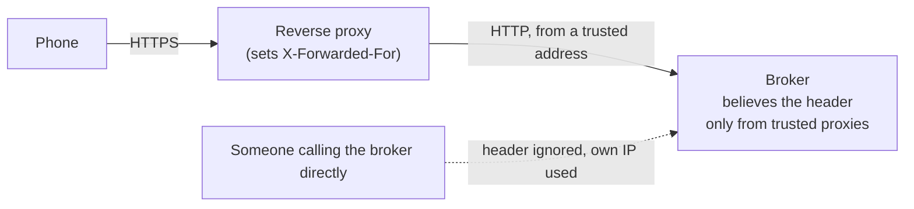

# Operations

## Settings

Every setting is a flag or an environment variable (the flag wins).

| flag | env | default | |
|---|---|---|---|
| `-addr` | `BR_ADDR` | `:8080` | listen address |
| `-db` | `BR_DB` | `data/broker.db` | SQLite file (its folder is created, mode 0700) |
| `-key-file` | `BR_KEY_FILE` | `data/server.key` | server signing key; created (0600) if missing |
| — | `BR_SERVER_KEY` | | the key as hex, instead of the file |
| — | `BR_PASSWORD` | | optional API password: only phones that send it may use the broker (see below) |
| `-password-file` | `BR_PASSWORD_FILE` | | the password from a file instead (e.g. a container secret) |
| `-max-days` | `BR_MAX_DAYS` | `60` | days kept per pair (1–366) |
| `-stale-days` | `BR_STALE_DAYS` | `10` | delete pairs not written for this long |
| `-cleanup-every` | `BR_CLEANUP_EVERY` | `1h` | clean-up job interval (≥ 1m) |
| `-max-pairs` | `BR_MAX_PAIRS` | `100000` | refuse new pairs above this |
| `-readers` | `BR_READERS` | `8` | read-only database connections |
| `-rate-limit` | `BR_RATE_LIMIT` | `true` | per-IP rate limits; `false` leaves all limiting to the reverse proxy |
| `-trusted-proxies` | `BR_TRUSTED_PROXIES` | `loopback` (image: `private`) | proxies whose client-IP header is believed: IPs, CIDRs, `loopback`, `private`, `none` |
| `-client-ip-header` | `BR_CLIENT_IP_HEADER` | `X-Forwarded-For` | the header those proxies put the client IP in (`X-Forwarded-For`, `X-Real-IP`, `CF-Connecting-IP`) |
| `-download-url` | `BR_DOWNLOAD_URL` | GitHub releases | the website's download button |
| `-source-url` | `BR_SOURCE_URL` | GitHub repo | footer link |
| `-author`, `-author-url` | `BR_AUTHOR`, `BR_AUTHOR_URL` | bruttazz, brutt.site | footer |
| `-version` | | | print the version (from the `VERSION` file) and exit |

Lowering `-max-days` takes effect at once (reads, writes and the next clean-up all use it). The
app never asks for more days than the server's `maxDays`.

## Deploying as a container

The image (`Containerfile`; published as `ghcr.io/bruttazz/better-red-broker` for every release) is
a static binary on distroless, running as the non-root user 65532, with no shell. Its only state
is the **`/data` volume** (declared with `VOLUME` and the label `site.brutt.better-red.volume`):

| file in `/data` | |
|---|---|
| `server.key` | signing key, created on first start (0600). **Back it up**, keep it secret |
| `broker.db`, `-wal`, `-shm` | the cache; losing it is harmless |

```bash
podman volume create better-red-data
podman run -d --name better-red-broker --restart unless-stopped \
  -p 127.0.0.1:8080:8080 -v better-red-data:/data \
  ghcr.io/bruttazz/better-red-broker:0.1.0
```

- A **named volume** starts out owned by the right user. A **host folder** must be owned by uid
  65532 first: `sudo install -d -o 65532 -g 65532 -m 0700 /srv/better-red`, then
  `-v /srv/better-red:/data` (add `:Z` on SELinux hosts).
- Settings are the `BR_*` environment variables above (or flags after the image name). The image
  sets `BR_ADDR=:8080`, `BR_DB=/data/broker.db`, `BR_KEY_FILE=/data/server.key` and
  `BR_TRUSTED_PROXIES=private` (a proxy on the host or in another container reaches it from a
  private address). So **publish the port only on `127.0.0.1`** (as above) or not at all (proxy on
  the same container network), never on a public interface: see "Behind a reverse proxy".
- Instead of the key file you can pass `BR_SERVER_KEY` from a secret.
- Private broker: add `-e BR_PASSWORD=…` (or mount a secret and set `BR_PASSWORD_FILE`).
- Health: `GET /healthz` (there's no shell in the image, so check it from outside, e.g. from
  the proxy or the orchestrator's HTTP probe).
- Stopping (`podman stop`, SIGTERM) finishes running requests first.
- Back up the key: `podman cp better-red-broker:/data/server.key ./server.key.backup` (and store it safely).

Compose:

```yaml
services:
  broker:
    image: ghcr.io/bruttazz/better-red-broker:0.1.0
    restart: unless-stopped
    ports: ["127.0.0.1:8080:8080"]   # only the proxy reaches it
    volumes: ["better-red-data:/data"]
volumes:
  better-red-data:
```

Build it yourself: `podman build -t better-red-broker --build-arg VERSION=$(cat VERSION) .`
(Docker: `docker build -f Containerfile ...`).

## A private broker (optional password)

By default a broker is open: any Better Red phone can pair through it (the data is end-to-end
encrypted either way). To keep a self-hosted broker to yourself and people you choose, give it a
password:

```bash
BR_PASSWORD='a-long-random-password' better-red-broker      # or: -password-file /run/secrets/br_password
```

- 1–128 printable ASCII characters, no spaces. Make it long and random (`openssl rand -base64 24`).
  It's never a flag (command lines are visible to other users of the machine).
- In the app, her phone types the server as **`password@your.domain`** (Partner → Change). The
  password goes into the pairing code, so the partner's phone gets it by scanning; nobody types it
  twice. The app never shows it on screen.
- Every API call then needs the `X-Better-Red-Password` header; without it: 401. The website,
  `/healthz` and `/v1/info` (which says `"password": true`) stay public. Wrong passwords count as
  failed authentication (10 per minute per IP, then 429).
- **Changing the password** cuts off every paired phone: she has to make a new pairing code with
  `newpassword@your.domain`, and the partner scans it. Removing it makes the broker open again
  (old phones keep working: an open broker ignores the header).
- It's an access gate, not encryption: what's stored was already unreadable to the server.

## Deploying (systemd example)

```bash
CGO_ENABLED=0 go build -trimpath -ldflags "-s -w" -o better-red-broker .
sudo install -m 0755 better-red-broker /usr/local/bin/
sudo useradd --system --home /var/lib/better-red --create-home better-red
```

`/etc/systemd/system/better-red-broker.service`:

```ini
[Unit]
Description=Better Red broker
After=network-online.target

[Service]
User=better-red
ExecStart=/usr/local/bin/better-red-broker -addr 127.0.0.1:8080 \
  -db /var/lib/better-red/broker.db -key-file /var/lib/better-red/server.key
Restart=on-failure
NoNewPrivileges=true
ProtectSystem=strict
ProtectHome=true
ReadWritePaths=/var/lib/better-red
PrivateTmp=true

[Install]
WantedBy=multi-user.target
```

The server stops cleanly on SIGTERM (finishes running requests, up to 10 s).

## Behind a reverse proxy

The broker speaks plain HTTP; put a reverse proxy in front for TLS (Caddy, nginx, Traefik,
Cloudflare). It works with any of them. The one thing to get right is **the client IP**, because
the broker rate-limits per IP (see "Rate limits" below).



How the broker picks the IP: if the request comes from an address in `-trusted-proxies`, it reads
`-client-ip-header`; otherwise it uses the connection's own address and ignores the header (anyone
can write anything in a header). `X-Forwarded-For` is read **from the right**, skipping your trusted
proxies: the first other address is the client. What the client wrote on the left is never used.

Checklist:

1. The broker listens only where the proxy can reach it: `-addr 127.0.0.1:8080`, a container port
   published on `127.0.0.1`, or a private container network. Not on a public interface.
2. `-trusted-proxies` lists the address the proxy connects *from*: `loopback` (default: proxy on the
   same machine), `private` (the image's default: proxy in another container, on the LAN, over a
   VPN), or explicit IPs/CIDRs (e.g. Cloudflare's ranges, https://www.cloudflare.com/ips/).
3. The proxy sets the header: `X-Forwarded-For` (default) or another one named in
   `-client-ip-header`. Caddy and Traefik do it by themselves; nginx needs the line below.
4. Check: the start-up log says `rate limits on; client IP from X-Forwarded-For when the peer is
   one of N trusted proxy ranges`. If every visitor shares one IP (the proxy's), steps 2 or 3 are
   wrong, and real users will hit the limits together.
5. Pass `/v1/*` through uncached; the website (`/`, `/static/*`) may be cached. Request bodies are at
   most 512 KB: keep the proxy's body limit at 1 MB or more.

**Caddy** (TLS automatic; sets `X-Forwarded-For` itself):

```
better-red.brutt.site {
    reverse_proxy 127.0.0.1:8080
}
```

**nginx**:

```nginx
server {
    listen 443 ssl http2;
    server_name better-red.brutt.site;
    # ssl_certificate / ssl_certificate_key ...
    client_max_body_size 1m;
    location / {
        proxy_pass http://127.0.0.1:8080;
        proxy_set_header Host $host;
        proxy_set_header X-Forwarded-For $proxy_add_x_forwarded_for;
        proxy_set_header X-Forwarded-Proto $scheme;
    }
}
```

**Cloudflare Tunnel** (recommended for better-red.brutt.site: no open port at all). `cloudflared`
connects to `http://127.0.0.1:8080` (or `http://broker:8080` on a container network) and sends
`CF-Connecting-IP`:

```bash
better-red-broker -addr 127.0.0.1:8080 -client-ip-header CF-Connecting-IP   # trusted: loopback (default)
# container next to cloudflared: BR_CLIENT_IP_HEADER=CF-Connecting-IP (trusted: private, the image default)
```

**Cloudflare in front of nginx/Caddy** (orange cloud): Cloudflare → your proxy → broker. Either let
your proxy turn `CF-Connecting-IP` into the client address (nginx `real_ip_header`, Caddy
`trusted_proxies`), or keep `X-Forwarded-For` and add Cloudflare's ranges to `-trusted-proxies`
(`loopback,173.245.48.0/20,...`) so the walk skips them too.

**Cloudflare settings** either way: SSL mode **Full (strict)**; a cache bypass rule for `/v1/*`
(the API also sends `no-store`); a rate-limiting rule on `POST /v1/pairs` (e.g. 10/hour per IP) and
Bot Fight Mode as a second layer; HSTS.

## Rate limits

Built in, on by default, per client IP (IPv6 grouped by /64):

| limit | what | over the limit |
|---|---|---|
| 2 requests/s, bursts of 60 | every request | `429 slow down` |
| 10 per hour, bursts of 5 | minting pair ids (`POST /v1/pairs`) | `429` |
| 10 per minute | failed authentication (bad pair id, device key or code) | that IP gets `429` on every authenticated call until it recovers |

One phone makes about 2 requests every 30 minutes, far below all of these.

**How they work:** token buckets **in memory** (a Go map per limit, `ratelimit.go`), not in SQLite
and not on disk. Each IP has a bucket that refills at the given rate; a request takes a token or gets
429. Full buckets are forgotten every 5 minutes, at most 200 000 IPs are tracked (past that, new
IPs are refused rather than letting memory grow), and a restart starts everyone fresh. They are not
shared between instances: if you ever run several, each limits on its own (or let the proxy do it).

**Turning them off:** `-rate-limit=false` (`BR_RATE_LIMIT=false`) disables all three, e.g. when the
proxy already limits and you don't want to set up the trusted-proxy part. Then the proxy **must**
limit, at least: all of `/v1/*` per IP, `POST /v1/pairs` strictly (10/hour), and failed calls
(responses 401/403) to stop people guessing codes. The start-up log warns while they are off.
Everything else (sizes, timeouts, validation, storage caps) stays on regardless.

## The database

- One file plus `-wal` and `-shm` next to it (WAL mode). Don't copy only the `.db` file while the
  server runs: use `sqlite3 broker.db ".backup backup.db"`, or stop the server first.
- Connections: one writer (`_txlock=immediate`, so writers queue instead of failing), N read-only
  readers (`query_only`). Pragmas on every connection: `busy_timeout=10000`, `synchronous=NORMAL`,
  `foreign_keys=ON`, `temp_store=MEMORY`, `cache_size=-16000`; the writer also sets
  `journal_size_limit=64MB`. The file uses `auto_vacuum=INCREMENTAL`.
- Backups of the database are optional: if it's lost, her phone refills it on its next sync.
  **Back up `server.key`**: with a different key every pair id is refused and everyone pairs again.
- Size: roughly 10–20 KB per active pair.

## Monitoring

- `GET /healthz` → `ok`.
- Logs: one line per request (`METHOD /route STATUS duration`), the clean-up summary every run,
  and errors. Nothing personal.
