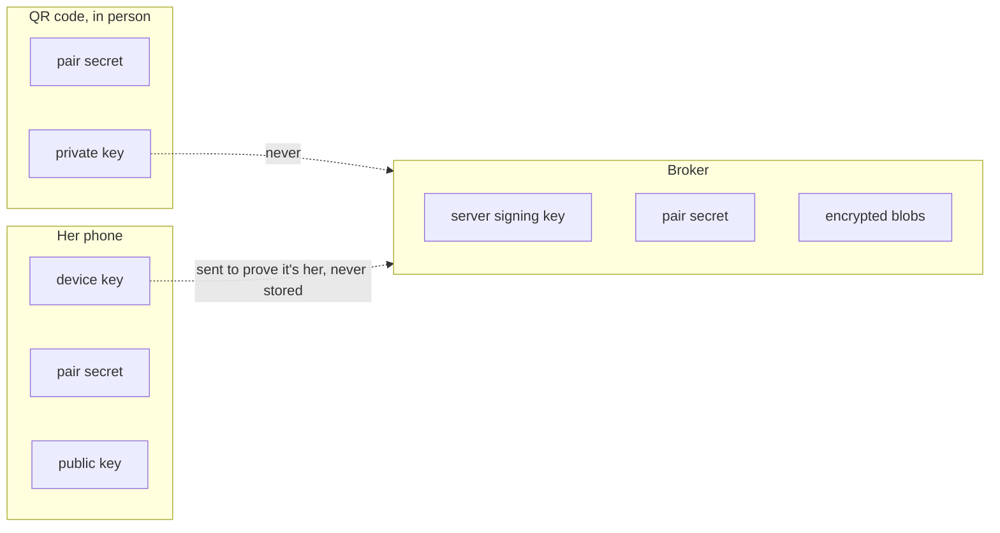

# Security

## What the broker can learn

| It sees | It can't see |
|---|---|
| that a pair exists, and its pair secret | her name, the days' contents, mood, symptoms, notes, cycle numbers |
| when her phone writes and when the partner reads | which days are period days: every day of the window is uploaded, padded to 64-byte steps (only a long note makes a blob bigger) |
| which date's `updatedAt` changed ("she edited the 20th") | the share private key (only in the QR code) |
| client IPs (in memory, for rate limits; never logged) | who she or the partner is |

Holding the pair secret lets the broker make valid read codes, but reading is pointless without
the private key. Choosing a broker you trust (or running your own) limits the metadata further.

## Threats and answers

**A curious or compromised broker** can't decrypt (no private key) and can't forge data the
partner accepts (forging needs the public key, which only her phone has; AES-GCM with the pair id
and day as associated data rejects swapped, edited or misplaced blobs). It *can* withhold, delete
or serve old copies: the partner then sees stale data or "waiting", never wrong data. Ephemeral
points are checked to be on the curve.

**Someone who learns a pair id** (e.g. from a proxy log) still needs the secret to read and her
device key to write. They can't mint for her device (that needs the device key, not the id).

**The partner** has the secret and the private key: they can read what she shares (that's the
feature). They can't write, delete or re-pair: all of that needs her device key.

**A stolen QR code / screenshot** reads until she makes a new code or unpairs. The app says so
next to the code and shows it only once.

**Data loss on the broker** is harmless: her phone writes everything again on its next sync.

**Network attackers**: HTTPS only (plain http only to a local test broker, debug builds). Codes
expire within about a minute. Her device key travels in a header over TLS; it only lets someone
write to *her* pairs, and is never stored.

**Guessing codes**: 8 digits, 5 valid at a time → 1 in 20 million per guess; 10 failed attempts per
minute per IP, then 429.

## Abuse and denial of service

- **Sizes**: mint body ≤ 1 KB, write body ≤ 512 KB, ≤ 64 keys, ≤ 4 KB per blob; unknown JSON
  fields or trailing data refused; headers ≤ 8 KB.
- **Timeouts**: 5 s headers, 15 s read, 20 s write, 60 s idle.
- **Rate limits per IP** (IPv6 by /64): 2 req/s (bursts of 60); 10 mints per hour; 10 failed
  authentications per minute. In-memory token buckets (no database, gone on restart); the limiter
  refuses new IPs past 200 000 tracked. Behind a proxy the client IP comes from `X-Forwarded-For`
  (or another header), believed only from `-trusted-proxies` and read from the right, so clients
  can't fake their way around the limits. `-rate-limit=false` hands limiting to the proxy
  (operations.md, "Rate limits").
- **Cheap rejection first**: pair ids are checked with an HMAC, and her device key with a hash,
  before any database work. Minting never writes rows.
- **Bounded storage**: 60-day window, 10-day expiry, `-max-pairs` rows (100 000 → a few GB at most).
- **Headers**: strict CSP (no scripts at all), `nosniff`,
  `no-referrer`, no framing; `no-store` on the API.
- **Logs**: method, path, status, duration. No IPs, no pair ids (they're in headers, not paths).

Put Cloudflare (or similar) in front for TLS, caching of the website, and its own rate limiting on
`POST /v1/pairs` (see operations.md, "Behind a reverse proxy").

## The server signing key

`server.key` signs pair ids. Keep it secret and **backed up**: with the same key, a fresh, empty
broker is refilled by the phones automatically; with a new key, every pair id is refused (403) and
everyone pairs again. Leaking it lets someone mint pair ids, which is useless without device keys
and secrets.
